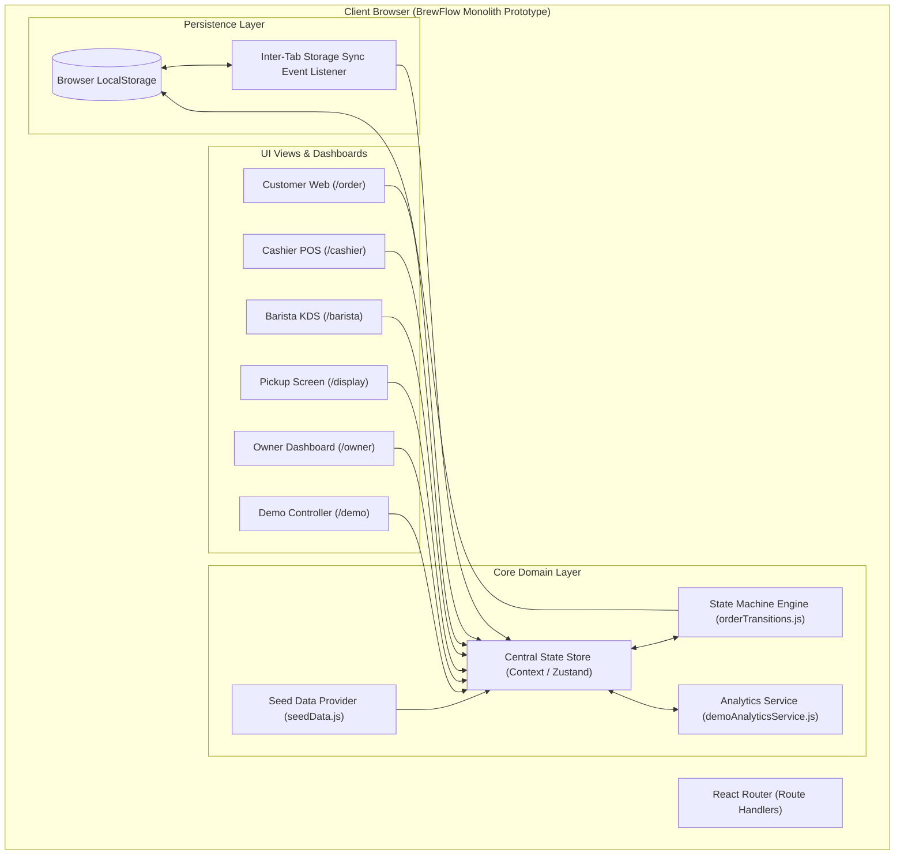

# BrewFlow — PRD

## 1. Executive Summary & Problem Statement

### Konsep Produk
**BrewFlow** adalah sebuah *interactive frontend prototype* yang merepresentasikan ekosistem digital terintegrasi untuk bisnis *specialty coffee shop* modern. Produk ini menghubungkan 5 titik operasional utama secara *real-time* dalam satu aplikasi:
1. **Customer Ordering Website & QR Table Ordering**
2. **Cashier Point of Sale (POS)**
3. **Barista Kitchen Display System (KDS)**
4. **Public Pickup Display Screen**
5. **Owner Business Intelligence & Analytics**

BrewFlow dirancang sebagai alat demonstrasi penjualan berstandar industri (*sales demo tool*) yang dapat disimulasikan secara langsung tanpa memerlukan *server backend*, *database* eksternal, atau *payment gateway* asli. Seluruh interaksi menggunakan *client-side state machine* yang kuat dan terikat pada *LocalStorage persistence*.

### Masalah yang Dipecahkan
1. **Sistem Operasional Kedai Kopi Terfragmentasi:** Banyak kedai kopi skala menengah menggunakan aplikasi terpisah untuk POS, antrean dapur, dan analitik, yang menyebabkan inkonsistensi status pesanan dan kehilangan data penjualan.
2. **Kebutuhan Demo Penjualan yang Andal:** Mengandalkan *backend sandbox* atau API eksternal saat mempresentasikan solusi ke calon klien berisiko mengalami kegagalan akibat masalah koneksi atau error server.
3. **Kompleksitas Alur Pesanan Kedai Kopi:** Perbedaan alur antara metode pembayaran tunai (bayar di kasir) dan digital (QRIS/E-Wallet), serta perbedaan tipe pesanan *Dine-in* vs *Takeaway*, sering kali memicu kerancuan pada antrean kerja barista.

### Nilai Utama & Keunggulan Produk
* **Deterministic Finite State Machine (FSM):** Seluruh transisi status pesanan dan pembayaran diproses melalui *service layer* terpusat (`orderTransitions.js`), menjamin bahwa status pesanan tidak dapat dilompati secara acak melalui manipulasi UI.
* **Dual Design Identity:** Antarmuka pelanggan mengusung gaya visual *editorial/lifestyle* yang mewah, sedangkan antarmuka operasional (Kasir, Barista, Owner) berorientasi pada kepadatan data (*high-density layout*), kemudahan pemindaian (*scannability*), dan efisiensi kerja.
* **Zero Backend Dependency & Multi-Tab Sync:** Menggunakan *browser state storage* dengan event listener inter-tab (`storage` event) sehingga simulasi dapat berjalan di multiple monitor (misal: Layar Kasir di Tab 1 dan Pickup Display di Tab 2) secara sinkron.
* **Real-time Calculated Analytics:** Seluruh grafik dan metrik statistik bisnis dihitung secara dinamis dari *dataset* pesanan aktif dan historis, tanpa angka acak (*dummy hardcoded numbers*).

---

## 2. Target User & User Stories (Gherkin Format)

### Definisi Segmen Pengguna
1. **Customer (Pelanggan):** Pengguna yang melakukan pemesanan via web langsung di meja (*Dine-in*) atau pemesanan *Takeaway*. Membutuhkan antarmuka intuitif, visual produk menarik, dan *real-time status tracking*.
2. **Cashier (Kasir):** Staf garda depan yang menerima pesanan, mengonfirmasi pembayaran tunai/digital, dan menyerahkan produk akhir ke pelanggan. Membutuhkan kecepatan eksekusi dan validasi pembayaran yang jelas.
3. **Barista (Staf Dapur):** Staf operasional pembuat minuman/makanan. Membutuhkan antarmuka KDS berformat kartu/antrean yang bersih, informatif (detail variasi/catatan), dan responsif pada perangkat tablet.
4. **Public / Customer Pickup Display:** Layar tampilan publik di area *counter* yang memberikan petunjuk visual status pesanan ("Diproses" vs "Siap Diambil") dengan tipografi besar.
5. **Owner (Pemilik Bisnis):** Pengambil keputusan yang memantau performa penjualan, produk terlaris, dan jam sibuk operasional secara *read-only*.
6. **Presenter / Demo Specialist:** Pengguna teknis yang mengoperasikan *Demo Control Center* untuk menjalankan skenario spesifik atau melakukan *reset state*.

---

### User Stories (Gherkin Format)

#### Story 1: Pemesanan QR Meja oleh Pelanggan (Customer)
```gherkin
Feature: Pemesanan Menu via QR Code Meja
  As a Pelanggan Dine-in
  I want to Membuka menu melalui pemindaian QR code meja
  So that Saya dapat memesan tanpa perlu mengantre di kasir dan nomor meja terisi otomatis

  Scenario: Pelanggan membuka link QR meja dengan parameter valid
    Given pelanggan memindai QR code di meja "B-01"
    When aplikasi membuka route "/order?table=B-01"
    Then sistem secara otomatis menetapkan tipe pesanan menjadi "Dine-in"
    And nomor meja "B-01" terkunci pada formulir checkout tanpa perlu diinput ulang oleh pelanggan
    And pelanggan dapat memilih item menu "Espresso Single Origin" dan memasukkannya ke keranjang
```

#### Story 2: Konfirmasi Pesanan dan Verifikasi Pembayaran Tunai (Cashier)
```gherkin
Feature: Verifikasi Pesanan dan Pembayaran oleh Kasir
  As a Kasir Kedai Kopi
  I want to Memeriksa pesanan masuk dan mengonfirmasi pembayaran
  So that Pesanan sah dapat diteruskan ke antrean barista

  Scenario: Kasir mengonfirmasi pesanan tunai dari pelanggan
    Given terdapat pesanan baru "#ORD-102" dengan status "pending_confirmation" dan paymentStatus "unpaid"
    When kasir membuka halaman "Pending Orders" di Cashier Dashboard
    And kasir menekan tombol "Konfirmasi Pesanan & Terima Tunai"
    Then sistem memanggil service "orderTransitions.js"
    And status pesanan berubah menjadi "confirmed"
    And status pembayaran berubah menjadi "paid"
    And pesanan "#ORD-102" secara otomatis muncul di antrean Live Queue Barista Dashboard
```

#### Story 3: Pemrosesan Pesanan oleh Barista (Barista)
```gherkin
Feature: Pemrosesan Antrean Pembuatan Minuman
  As a Barista
  I want to Mengubah status pesanan dari antrean menjadi sedang dibuat lalu siap
  So that Pembuatan minuman teratur dan kasir/pelanggan tahu progres pesanan

  Scenario: Barista memulai dan menyelesaikan pembuatan pesanan
    Given pesanan "#ORD-102" berada di antrean Barista dengan status "confirmed" dan paymentStatus "paid"
    When barista menekan tombol "Mulai Buat" pada kartu pesanan
    Then status pesanan berubah menjadi "preparing"
    And waktu mulai pembuatan dicatat oleh sistem
    When barista selesai membuat minuman dan menekan tombol "Tandai Siap"
    Then status pesanan berubah menjadi "ready"
    And nomor pesanan "#ORD-102" muncul pada section "Siap Diambil" di Pickup Display
```

#### Story 4: Pemantauan Tampilan Layar Publik (Pickup Display)
```gherkin
Feature: Perubahan Otomatis Layar Pickup
  As a Pelanggan yang Menunggu
  I want to Melihat nomor pesanan saya di layar publik saat siap
  So that Saya tahu kapan harus mengambil pesanan di counter

  Scenario: Pesanan berubah menjadi Siap di Layar Display
    Given layar publik berada pada route "/display"
    When pesanan "#ORD-102" diperbarui statusnya menjadi "ready" oleh barista
    Then layar "/display" memperbarui tampilan secara otomatis tanpa reload manual
    And nomor pesanan "#ORD-102" berpindah dari kolom "Sedang Disiapkan" ke kolom "Siap Diambil" dengan animasi visual yang jelas
```

#### Story 5: Perhitungan Analitik Penjualan Akurat (Owner)
```gherkin
Feature: Kalkulasi Analitik Penjualan Berdasarkan Transaksi Valid
  As a Owner
  I want to Melihat total pendapatan dan produk terlaris yang dihitung secara real-time
  So that Saya mendapatkan data bisnis yang presisi tanpa menyertakan pesanan batal/ditolak

  Scenario: Pesanan diselesaikan dan masuk ke dalam kalkulasi analitik
    Given total pendapatan saat ini adalah Rp 150.000 dari 3 pesanan "completed"
    And terdapat 1 pesanan "#ORD-105" dengan status "rejected" bernilai Rp 50.000
    When pesanan baru "#ORD-106" bernilai Rp 40.000 berubah status menjadi "completed"
    Then Owner Dashboard memperbarui total pendapatan menjadi Rp 190.000
    And pesanan "#ORD-105" yang "rejected" tetap diabaikan dari kalkulasi total penjualan
```

---

## 3. Feature Breakdown & Scope (MVP vs Phase 2)

| Nama Fitur | Scope Modul | Prioritas | Purpose / Tujuan Bisnis |
| :--- | :--- | :--- | :--- |
| **Catalog & QR Parameter Engine** | Customer Web | **P0 (MVP)** | Memungkinkan pemesanan berbasis QR meja (`/order?table=X`) dan eksplorasi menu berdasarkan kategori. |
| **Cart & Customization Modal** | Customer Web | **P0 (MVP)** | Mengelola variasi produk (Size, Sugar Level, Milk Choice) dan catatan khusus. |
| **Finite State Machine Service** | Core Engine | **P0 (MVP)** | Menjamin keamanan aturan bisnis dan transisi status yang valid (`orderTransitions.js`). |
| **Cashier Order & Payment POS** | Cashier Dashboard | **P0 (MVP)** | Mengelola verifikasi pembayaran (Cash/Digital), penerimaan, dan penolakan pesanan. |
| **Barista KDS View** | Barista Dashboard | **P0 (MVP)** | Antrean pembuatan minuman berformat kartu berbasis waktu (*chronological queue*). |
| **Public Pickup Screen (`/display`)** | Pickup Display | **P0 (MVP)** | Layar indikator publik tipografi besar untuk pemanggilan nomor pesanan secara visual. |
| **Owner Analytics Dashboard** | Owner Dashboard | **P0 (MVP)** | Menyajikan data agregat penjualan, *best-seller*, dan *payment method distribution*. |
| **Demo Control Center & Reset** | Control Center | **P0 (MVP)** | Menyediakan *scenario runner* untuk kebutuhan presentasi dan tombol *reset seed state*. |
| **Multi-Tab Sync Engine** | Infrastructure | **P1 (MVP)** | Menyingkronkan perubahan *state* antar tab browser menggunakan `window.addEventListener('storage')`. |
| **Audio Notification System** | Operational UI | **P2 (Phase 2)** | Membunyikan suara *chime* saat pesanan baru masuk di kasir atau status berubah menjadi *ready*. |
| **Thermal Receipt Printing** | Cashier Dashboard | **P2 (Phase 2)** | Integrasi WebBluetooth / WebUSB untuk cetak struk ke printer kasir fisik. |
| **Advanced Inventory Auto-Deduction**| Owner / KDS | **P2 (Phase 2)** | Pengurangan stok biji kopi dan susu secara otomatis berdasarkan resep tiap porsi. |

---

## 4. Technical Architecture & Task Breakdown

### Arsitektur Aplikasi
Aplikasi dibangun sebagai **Client-Side Single Page Application (SPA)** dengan pendekatan *Domain-Driven State Architecture*. Komunikasi antar komponen tidak dilakukan melalui modifikasi variabel lokal secara langsung, melainkan melalui **BrewFlow State Manager & Service Layer**.



---

### Task Breakdown per Layer

#### Layer 1: Database Schema & Domain Logic (Core)
* **Task 1.1 — Schema & Seed Data Definition (`seedData.js`)**
  * Buat struktur data JSON untuk Products, Categories, Tables, Initial Orders, dan Initial Payments.
  * *Penting:* Setiap pesanan menyimpan *snapshot* produk (Nama, Harga Satuan saat dipesan, Options, Subtotal) agar tidak terpengaruh jika katalog produk berubah.
* **Task 1.2 — Finite State Machine Engine (`orderTransitions.js`)**
  * Matriks Transisi Pesanan:
    * `pending_confirmation` ➔ `confirmed` | `rejected`
    * `confirmed` (jika `unpaid`) ➔ `awaiting_payment`
    * `awaiting_payment` / `confirmed` (jika `paid`) ➔ `preparing`
    * `preparing` ➔ `ready`
    * `ready` ➔ `completed`
  * Matriks Transisi Pembayaran:
    * `unpaid` ➔ `pending` ➔ `paid` | `failed` | `refunded`
  * Buat guard clause yang mengembalikan object `{ success: boolean, error?: string, newState?: Order }`.
* **Task 1.3 — Persistence & Sync Adapter (`demoStorageService.js`)**
  * Buat *wrapper* `localStorage` dengan penanganan skema versi (`BREWFLOW_SCHEMA_V1`).
  * Pasang `window.addEventListener('storage')` untuk memicu pembaruan state saat terjadi perubahan data di tab lain.

#### Layer 2: Frontend Layouts & Shared UI Components
* **Task 2.1 — Global Theme & Design Tokens System**
  * Konfigurasi Tailwind CSS dengan palet warna custom: `espresso` (#1A0F0D), `roast` (#3D231D), `cream` (#FDFBF7), `latte` (#E8DCC4), dan `amber-accent` (#D97706).
  * Buat komponen UI dasar: `Button`, `Badge` (indikator status), `Modal`, `Card`, `ToastNotification`, dan `Table`.
* **Task 2.2 — Role Navigation & Switcher Header**
  * Buat *Demo Role Switcher Bar* mengambang di bagian atas layar untuk berpindah antar *view* (Customer, Cashier, Barista, Display, Owner, Demo Control) tanpa mereset data.

#### Layer 3: Feature Modules Implementation
* **Task 3.1 — Customer Experience Module (`/`, `/menu`, `/order`, `/cart`, `/tracker`)**
  * Implementasi pengenalan URL SearchParams `?table=B-01`.
  * Halaman katalog dengan filter kategori (Espresso Based, Manual Brew, Non-Coffee, Pastry).
  * Modal kustomisasi produk (Pilihan Suhu: Hot/Iced, Level Gula: 0%/50%/100%, Jenis Susu: Oat Milk/Fresh Milk).
  * Form Checkout dengan pilihan *Dine-in* / *Takeaway* dan simulasi metode pembayaran (Cash at Cashier, QRIS, Digital Wallet).
  * Halaman *Order Tracker* dinamis dengan stepper visual status pesanan.
* **Task 3.2 — Cashier POS Module (`/cashier`)**
  * View tabulasi: Pending Confirmation, Active Orders, Ready for Pickup, History.
  * Modal verifikasi pembayaran tunai/digital dan konfirmasi penolakan pesanan (dengan alasan penolakan).
* **Task 3.3 — Barista KDS Module (`/barista`)**
  * Grid layout berbasis kartu yang responsif untuk tablet.
  * Indikator durasi waktu sejak pesanan dikonfirmasi (*elapsed timer*).
  * Tombol aksi satu-klik: "Mulai Buat" dan "Tandai Siap".
* **Task 3.4 — Public Pickup Display Module (`/display`)**
  * Layout layar penuh dengan kontras tinggi (Latar belakang Espresso gelap).
  * Dua kolom utama: **SEDANG DIPROSES** (Status: `preparing`) dan **SIAP DIGULINGKAN / DIAMBIL** (Status: `ready`).
* **Task 3.5 — Owner Analytics Module (`/owner`)**
  * Integrasi modul `demoAnalyticsService.js` untuk agregasi data *real-time*.
  * Widget Statistik: Total Revenue (hanya dari status `completed`), Total Volume Pesanan, Average Order Value (AOV).
  * Tampilan Grafik ringkasan penjualan harian/mingguan dan list *Top 5 Best-Selling Products*.
* **Task 3.6 — Demo Control Center (`/demo`)**
  * Panel kontrol khusus untuk instruktur/presenter.
  * Tombol "Reset Demo Data" untuk mengembalikan state ke data seed awal.
  * Skenario Otomatis: Tombol "Simulasikan Pesanan Masuk Cepat" untuk kebutuhan demonstrasi instan.

---

## 5. Risk Assessment & Edge Cases

### Risiko Teknis & Produk

| Potensi Risiko | Tingkat Dampak | Langkah Mitigasi (*Mitigation Strategy*) |
| :--- | :--- | :--- |
| **Inkonsistensi State antar Tab Browser** | **High** | Menggunakan `storage event listener` pada `window` yang memaksa *root state store* memperbarui memory ketika `localStorage` diubah oleh tab/layar lain. |
| **Corrupted Data pada LocalStorage Client** | **High** | Terapkan versi skema (`BREWFLOW_SCHEMA_V1`). Jika parsing JSON gagal atau struktur data tidak valid, sistem secara otomatis melakukan *fallback* aman dan mereset ke `seedData.js`. |
| **Lompatan Status Ilegal via UI Direct Call** | **Medium** | Semua aksi pembaruan status **WAJIB** melewati `orderTransitions.processTransition()`. Komponen UI tidak diizinkan mengubah properti status secara langsung. |
| **Penghitungan Analitik Penjualan yang Salah** | **Medium** | Terapkan isolasi logika pada `demoAnalyticsService.js`. Hanya pesanan berstatus `completed` dengan pembayaran `paid` yang masuk dalam agregasi keuangan. |

---

### Penanganan Edge Cases Utama

1. **Pemesanan Tanpa Parameter Meja pada Mode Dine-in:**
   * *Kondisi:* Pelanggan memilih metode *Dine-in* melalui URL langsung `/order` tanpa parameter `?table=...`.
   * *Penanganan:* Formulir checkout akan menampilkan *dropdown* pemilihan meja wajib (*required field*) dengan daftar meja yang tersedia dari *seed data*.

2. **Penolakan Pesanan yang Sudah Dibayar Digital (Refund Logic Simulation):**
   * *Kondisi:* Kasir menolak pesanan yang status pembayarannya sudah `paid` (simulasi e-wallet).
   * *Penanganan:* FSM menetapkan status pesanan menjadi `rejected` dan secara otomatis memperbarui `paymentStatus` menjadi `refunded`. Catatan alasan penolakan disimpan di audit log pesanan.

3. **Perubahan Harga Katalog Tidak Mempengaruhi Pesanan Lama:**
   * *Kondisi:* Owner atau admin mengubah harga "Café Latte" dari Rp 35.000 menjadi Rp 40.000.
   * *Penanganan:* Pesanan aktif dan historis menyimpan objek *snapshot* item (`{ productId, snapshotName, priceAtPurchase, qty }`), sehingga nilai transaksi historis tetap akurat.

4. **Multi-User Editing Conflict (Kasir & Barista Menindak Pesanan Bersamaan):**
   * *Kondisi:* Kasir membatalkan pesanan pada saat yang bersamaan ketika Barista menekan "Mulai Buat".
   * *Penanganan:* FSM melakukan validasi *atomic status check*. Transisi kedua akan gagal dan menampilkan *toast notification*: `"Aksi Gagal: Status pesanan telah diperbarui oleh pengguna lain."`

---

## 6. Roadmap Implementasi (Start to End)

```
[Sprint 1: Core Engine] ---> [Sprint 2: Customer Experience] ---> [Sprint 3: Operations (POS & KDS)]
                                                                           |
[Sprint 5: Integration & QA] <--- [Sprint 4: Display & Analytics] <--------+
```

### Tahap 1: Core Engine & Data Foundation (Sprint 1)
* **Deliverables:**
  * Setup repository React + Vite + Tailwind CSS + Lucide React.
  * Modul `seedData.js` memuat data awal produk, meja, dan historis pesanan.
  * Engine FSM `orderTransitions.js` lengkap dengan seluruh *rules* dan validasi.
  * Service `demoStorageService.js` untuk persistensi `localStorage` dan event listener sinkronisasi antar tab.
* **Kriteria Selesai:** Unit tes internal terbukti menolak transisi status ilegal (misal: pesanan `pending_confirmation` langsung diubah menjadi `completed`).

### Tahap 2: Customer Ordering Experience (Sprint 2)
* **Deliverables:**
  * Layout web pelanggan responsive (*Editorial Theme*).
  * Halaman Katalog, Filter Kategori, dan Modal Kustomisasi Menu.
  * Logika ekstraksi nomor meja dari query String parameter `?table=X`.
  * Drawer Keranjang Belanja dan Halaman Checkout.
  * Halaman *Order Tracker* dinamis.
* **Kriteria Selesai:** Pelanggan dapat menyelesaikan alur pemesanan hingga mendapatkan nomor pesanan dan status `pending_confirmation`.

### Tahap 3: Operational Dashboards — Cashier & Barista (Sprint 3)
* **Deliverables:**
  * Antarmuka Kasir POS: Modul verfirmasi pesanan, pemrosesan pembayaran tunai, dan penolakan pesanan.
  * Antarmuka Barista KDS: Antrean kartu pesanan berdasarkan waktu masuk, tombol aksi pemrosesan ("Mulai Buat", "Tandai Siap").
  * Modal konfirmasi aksi final dan sistem Toast Notification.
* **Kriteria Selesai:** Pesanan dari pelanggan muncul di Kasir, setelah dikonfirmasi berpindah ke KDS Barista, dan dapat diproses hingga status `ready`.

### Tahap 4: Pickup Display, Owner Analytics & Control Center (Sprint 4)
* **Deliverables:**
  * Route tampilan publik `/display` dengan update *real-time*.
  * Dashboard Analitik Owner dengan grafik statistik dan indikator performa bisnis (Revenue, AOV, Best Seller).
  * Demo Control Center (`/demo`) beserta fitur *Scenario Runner* dan *Hard Reset*.
* **Kriteria Selesai:** Perubahan status di Barista langsung memicu perubahan posisi nomor pesanan di Tampilan Pickup secara instan tanpa *refresh* halaman.

### Tahap 5: End-to-End Integration, Validation & Polish (Sprint 5)
* **Deliverables:**
  * Uji coba alur penuh (*End-to-End Simulation*) dari pemindaian QR hingga penyelesaian pesanan dan pembaruan grafik analitik.
  * Pengujian sinkronisasi multi-tab secara bersamaan di 3 jendela browser terpisah.
  * Polish UI/UX: Transisi halus, *skeleton loader*, *fallback image* jika URL gambar gagal dimuat, dan penyempurnaan tipografi.
* **Kriteria Selesai:** Seluruh 18 poin pada *Acceptance Criteria* terpenuhi tanpa kesalahan *runtime* atau kerusakan *state*.

---

### Langkah Lanjutan yang Disarankan

Dokumen PRD ini siap digunakan sebagai acuan pengembangan penuh. Anda dapat meminta saya untuk melakukan salah satu dari langkah lanjutan berikut:
1. **Generate Struktur Direktori & Kode Inisialisasi:** Membuatkan struktur *folder* proyek React lengkap beserta file `orderTransitions.js` dan `seedData.js`.
2. **Generate Prompt Implementasi Component:** Membuat *prompt* spesifik per komponen UI (seperti KDS Barista atau Dashboard Analitik Owner) untuk langsung dieksekusi oleh tim developer/AI coding assistant.